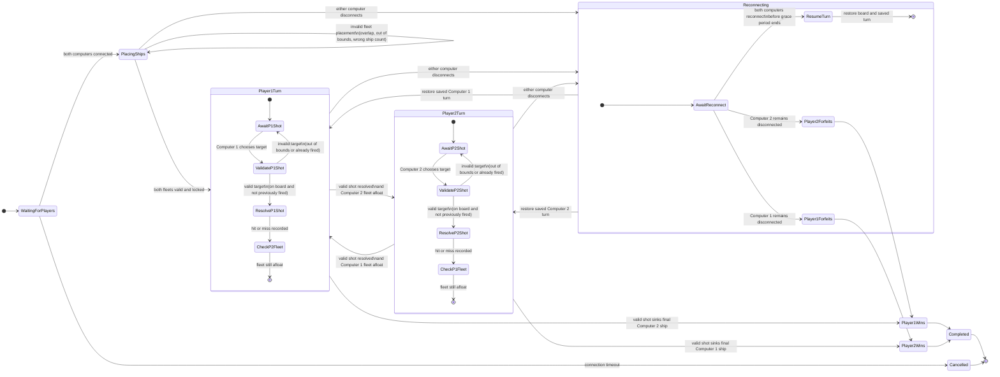
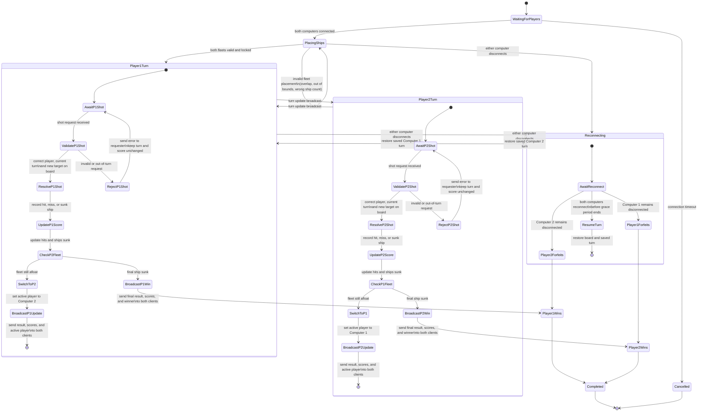
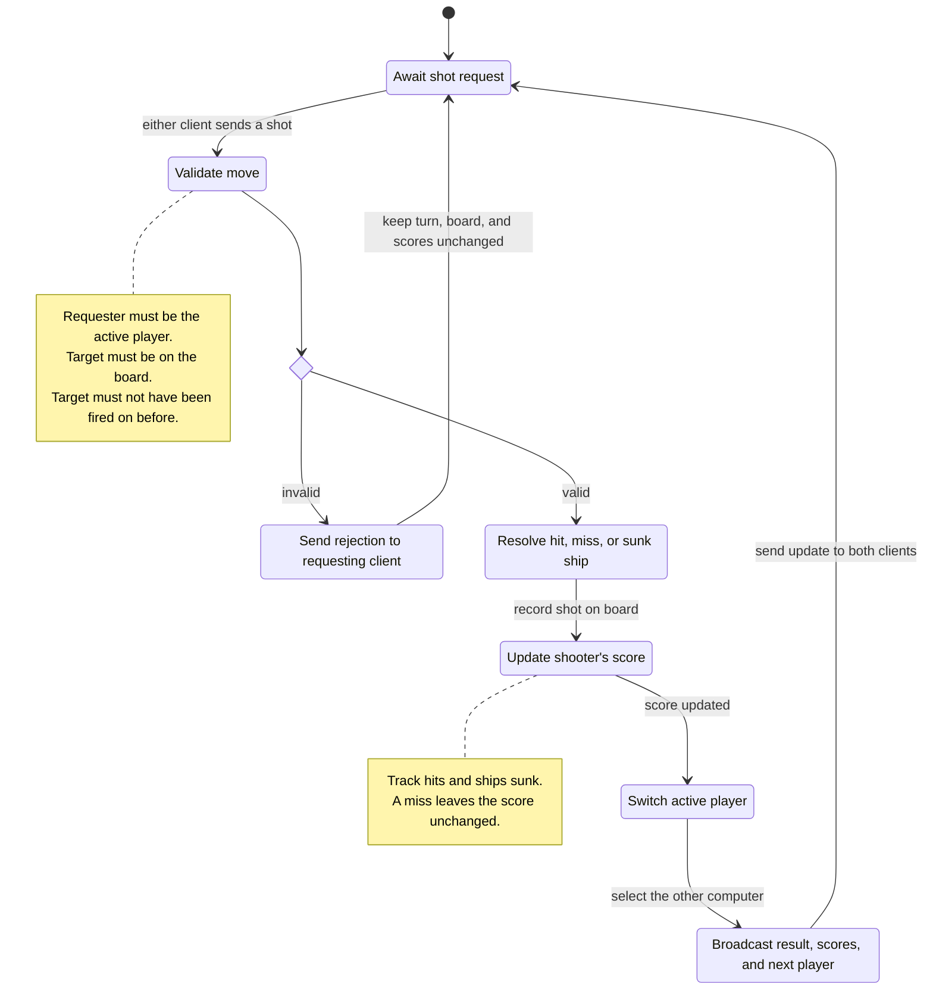
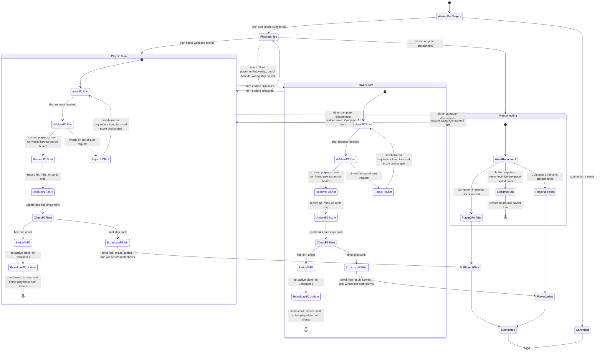
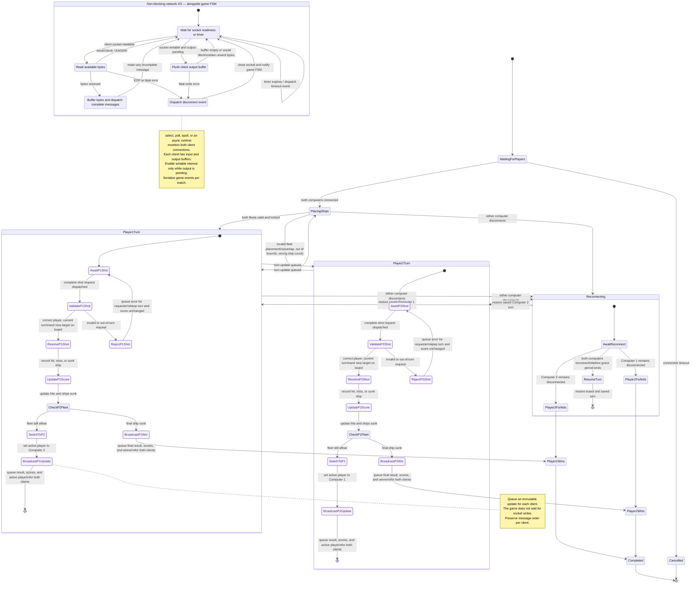

# AI Prompts
  This is a page specifying AI chatlogs for documentation on where and how I created components of this project.
  
  Mermaid.ai prompts / chatlog
  
  Chatgpt prompts / chatlog
  
  Other citations that I found along the way that I found to be helpful

## Mermaid.ai
  I used mermaid.ai to create the finite state machine ([found under fsm_specification.md](https://github.com/zlauer/CS-457-project/blob/main/docs/fsm_specification.md))

I asked for examples of what it would be able to generate initially, mostly to get a grasp on what the outcome would look like.  It provided me with two separate examples of fsm diagrams which helped greatly!  I then asked specifics for the project I'm creating.

**mermaid.ai:** What should the diagram illustrate?

**prompt:**  A multiplayer game request sequence. i would like an game finite state machine diagram that details the valid moves, invalid moves and sudden disconnects for a game of battleship being played between two computers, please!

**mermaid.ai** then provided this fsm, which though helpful, did not include everything I needed:

I then asked how I would import to GitHub, which led to the initial version of the fsm_specification page - which is now updated with another, edited form of the diagram.

**prompt:** can you help me understand what turn switches would like look? this would include turn switches, move validation and score updates being broadcast to the client

```mermaid
stateDiagram-v2
    direction LR

    [*] --> WaitingForPlayers
    WaitingForPlayers --> PlacingShips: both computers connected
    WaitingForPlayers --> Cancelled: connection timeout

    PlacingShips --> Player1Turn: both fleets valid and locked
    PlacingShips --> PlacingShips: invalid fleet placement\n(overlap, out of bounds, wrong ship count)
    PlacingShips --> Reconnecting: either computer disconnects

    state Player1Turn {
        [*] --> AwaitP1Shot
        AwaitP1Shot --> ValidateP1Shot: shot request received
        ValidateP1Shot --> ResolveP1Shot: correct player, current turn\nand new target on board
        ValidateP1Shot --> RejectP1Shot: invalid or out-of-turn request
        RejectP1Shot --> AwaitP1Shot: send error to requester\nkeep turn and score unchanged
        ResolveP1Shot --> UpdateP1Score: record hit, miss, or sunk ship
        UpdateP1Score --> CheckP2Fleet: update hits and ships sunk
        CheckP2Fleet --> SwitchToP2: fleet still afloat
        SwitchToP2 --> BroadcastP1Update: set active player to Computer 2
        BroadcastP1Update --> [*]: send result, scores, and active player\nto both clients
        CheckP2Fleet --> BroadcastP1Win: final ship sunk
    }

    state Player2Turn {
        [*] --> AwaitP2Shot
        AwaitP2Shot --> ValidateP2Shot: shot request received
        ValidateP2Shot --> ResolveP2Shot: correct player, current turn\nand new target on board
        ValidateP2Shot --> RejectP2Shot: invalid or out-of-turn request
        RejectP2Shot --> AwaitP2Shot: send error to requester\nkeep turn and score unchanged
        ResolveP2Shot --> UpdateP2Score: record hit, miss, or sunk ship
        UpdateP2Score --> CheckP1Fleet: update hits and ships sunk
        CheckP1Fleet --> SwitchToP1: fleet still afloat
        SwitchToP1 --> BroadcastP2Update: set active player to Computer 1
        BroadcastP2Update --> [*]: send result, scores, and active player\nto both clients
        CheckP1Fleet --> BroadcastP2Win: final ship sunk
    }

    Player1Turn --> Player2Turn: turn update broadcast
    Player2Turn --> Player1Turn: turn update broadcast
    BroadcastP1Win --> Player1Wins: send final result, scores, and winner\nto both clients
    BroadcastP2Win --> Player2Wins: send final result, scores, and winner\nto both clients

    Player1Turn --> Reconnecting: either computer disconnects
    Player2Turn --> Reconnecting: either computer disconnects

    state Reconnecting {
        [*] --> AwaitReconnect
        AwaitReconnect --> ResumeTurn: both computers reconnect\nbefore grace period ends
        AwaitReconnect --> Player1Forfeits: Computer 1 remains disconnected
        AwaitReconnect --> Player2Forfeits: Computer 2 remains disconnected
        ResumeTurn --> [*]: restore board and saved turn
    }

    Reconnecting --> Player1Turn: restore saved Computer 1 turn
    Reconnecting --> Player2Turn: restore saved Computer 2 turn

    Player1Forfeits --> Player2Wins
    Player2Forfeits --> Player1Wins
    Player1Wins --> Completed
    Player2Wins --> Completed
    Completed --> [*]
    Cancelled --> [*]
```

The server now validates → resolves the shot → updates scores → switches turns → broadcasts to both clients; invalid requests return an error without changing the turn or score. This assumes turns alternate even after a hit, “score” means hits and ships sunk, and broadcasts never reveal unhit enemy ship positions.

**prompt:** can you keep it a state diagram but maybe have a more vertical presentation?

Changed the overall diagram and nested states to top-to-bottom (TB) while keeping the game logic unchanged. Branches may still appear side by side to accommodate validation and disconnect paths.

  **prompt:** could you create a seperate diagram with the turn switches, move validation, and score updates indepenent from the overall behavior of the game?

This standalone state diagram shows the server’s turn-processing cycle for either computer, with turns alternating after every valid shot. Setup, disconnects, and game-ending behavior remain outside this diagram; broadcasts reveal shot results, not hidden ship positions.

**prompt:** can you highlight on the overall diagram where these go? in blue or purple, your choice :)

The purple states show where the standalone turn-processing cycle fits into both players’ turns: receiving and validating moves, resolving shots, updating scores, switching turns, and broadcasting updates. The overall game logic and vertical layout remain unchanged.

**prompt:** with this diagram, can you show me what it may look like with the addition of non/blocking or io multiplexing? if there is a change that way

The game rules stay the same; the added network I/O state machine handles both connections alongside the game FSM, without requiring a separate thread. Broadcasts now queue updates instead of waiting for delivery, while the I/O loop handles partial reads/writes, disconnects, and timeout events.

**prompt:** is there turn enforcement within the turn-based portions of this diagram?

**mermaid.ai:** Yes—turn enforcement is represented in both players’ validation steps:

ValidateP1Shot accepts a shot only from Computer 1 during its turn, targeting an on-board cell it has not already fired at.
ValidateP2Shot applies the same checks for Computer 2.
Invalid or out-of-turn requests go to RejectP1Shot / RejectP2Shot. The server queues an error for the requester and leaves the turn, board, and scores unchanged.
After a valid, non-winning shot, SwitchToP2 / SwitchToP1 changes the active player before queuing the update to both clients.
Non-blocking I/O does not bypass these checks. The network layer can receive messages from either computer at any time, but it must dispatch them to the currently active turn’s validator. For example, a Computer 2 shot received during Player1Turn goes through ValidateP1Shot and is rejected.

The diagram describes this enforcement; your server code must implement it. Processing game events one at a time per match keeps validation, board/score updates, and turn switching from overlapping. For stronger protection against delayed or duplicate requests, include a turn ID and request ID in each shot request.
  
