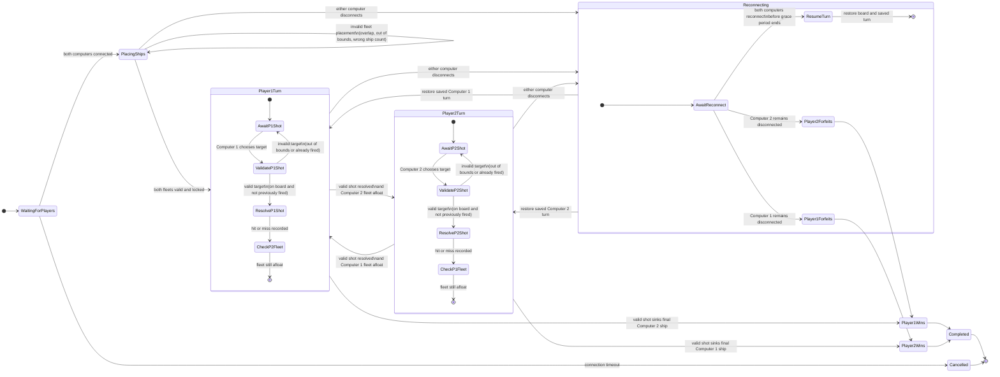

# AI Prompts
  This is a page specifying AI chatlogs for documentation on where and how I created components of this project.
  
  Mermaid.ai prompts / chatlog
  
  Chatgpt prompts / chatlog
  
  Other citations that I found along the way that I found to be helpful

## Mermaid.ai
  I used mermaid.ai to create the finite state machine ([found under fsm_specification.md](https://github.com/zlauer/CS-457-project/blob/main/docs/fsm_specification.md))

I asked for examples of what it would be able to generate initially, mostly to get a grasp on what the outcome would look like.  It provided me with two separate examples of fsm diagrams which helped greatly!  I then asked specifics for the project I'm creating.

**mermaid.ai:** What should the diagram illustrate?

**prompt:**  A multiplayer game request sequence. i would like an game finite state machine diagram that details the valid moves, invalid moves and sudden disconnects for a game of battleship being played between two computers, please!

**mermaid.ai** then provided this fsm, which though helpful, did not include everything I needed:

I then asked how I would import to GitHub, which led to the initial version of the fsm_specification page - which is now updated with another, edited form of the diagram.
  

  
