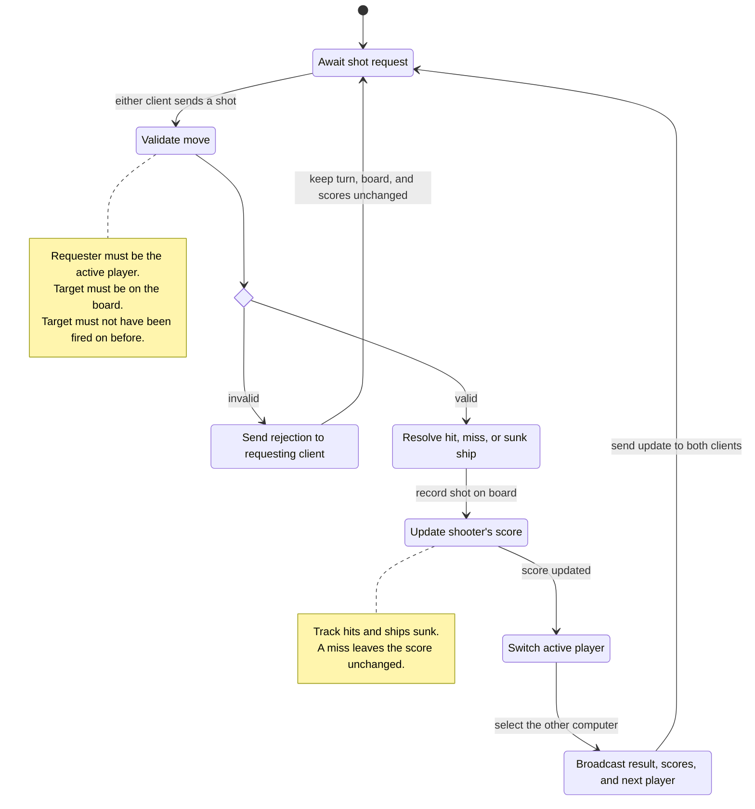
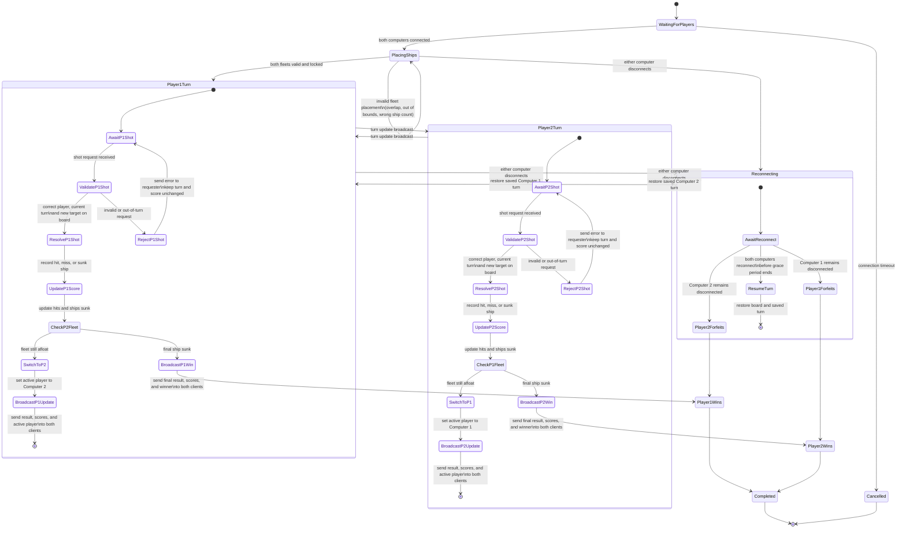

Within this presented diagram, there are both validations of movements and rejections of movements.  These include within the realm of a player selecting a spot outside of their own turn, and then subsequently throwing out that turn.

---
Here is an updated version of the specification diagram featuring these movements:

