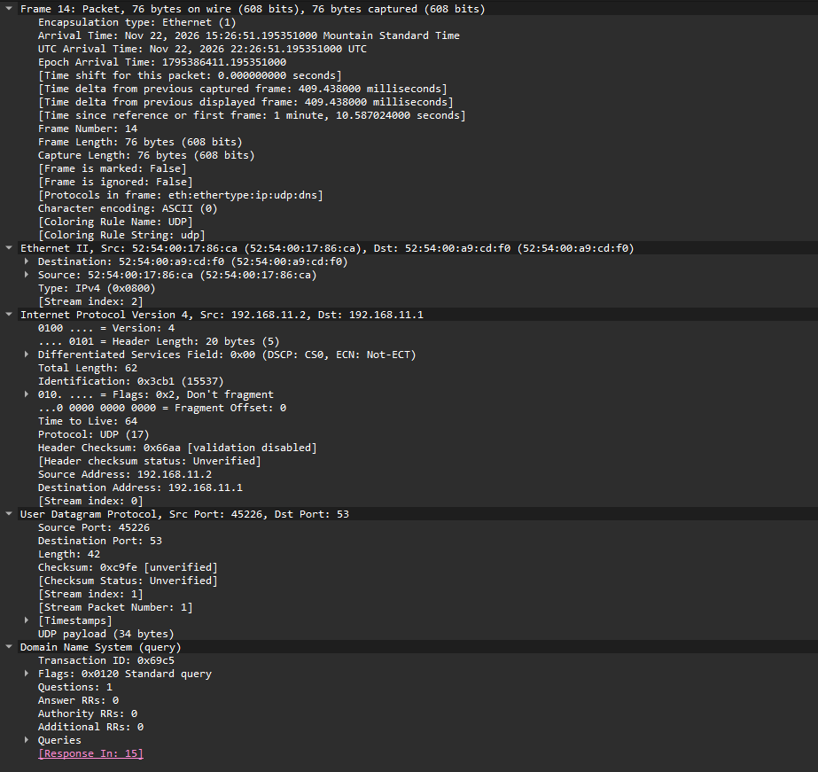
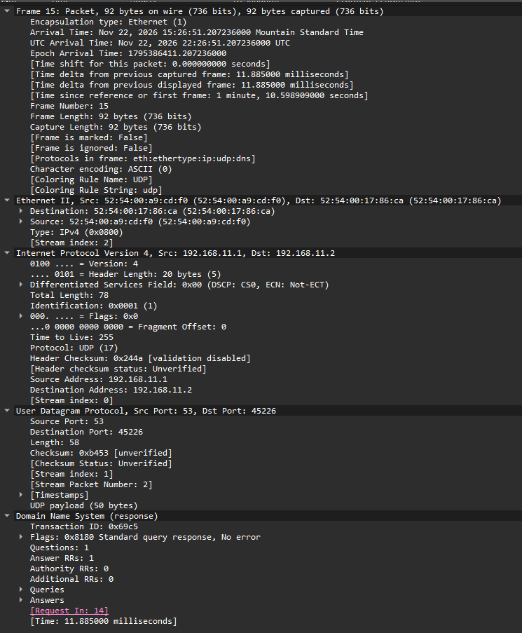

Comprehensive verification report including topology screenshot with custom node names (<initials>-Client1, <initials>-Client2, <initials>-Server, <initials>-R1), CLI outputs (show ip int br, show ip route, show ip dhcp binding), client command logs (ping 192.168.20.100,, and annotated Wireshark DNS exchange.

###  Annotated Wireshark DNS Exchange.

.png?raw=true)

This is a screenshot detailing where in the packets the DNS query was performed.

These are two screenshots detailing the Query being sent from the first client to the server, and the response thereafter.
