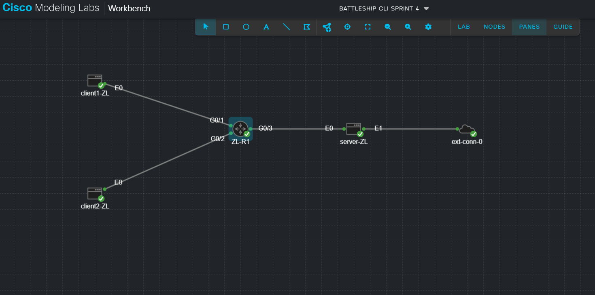
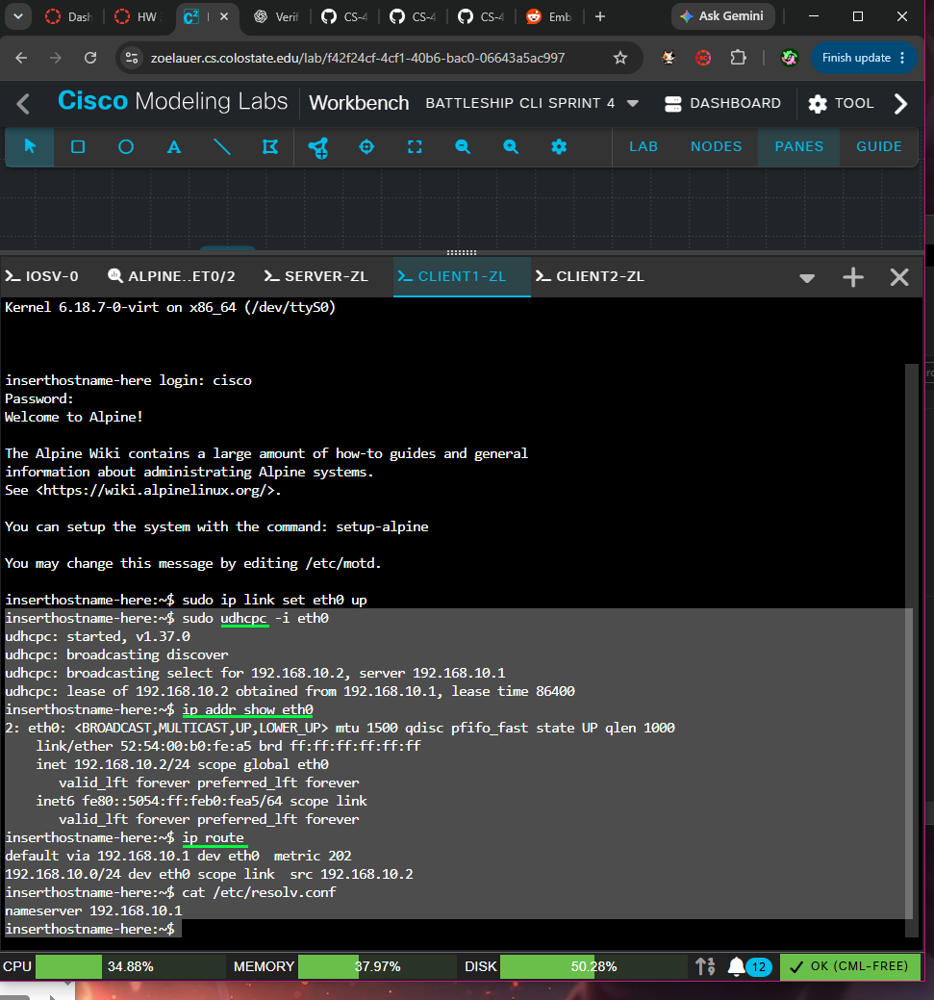
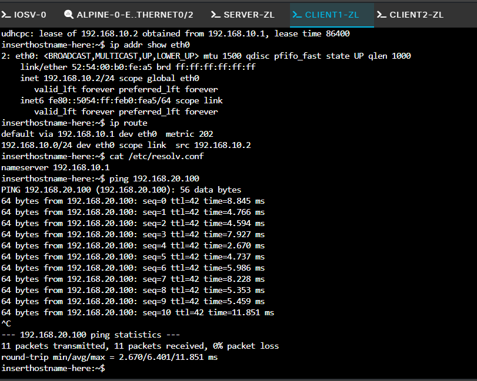
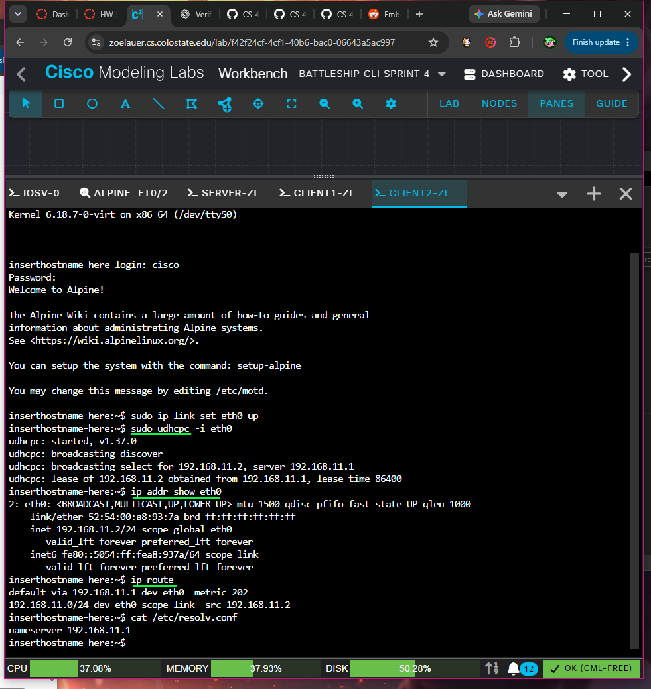
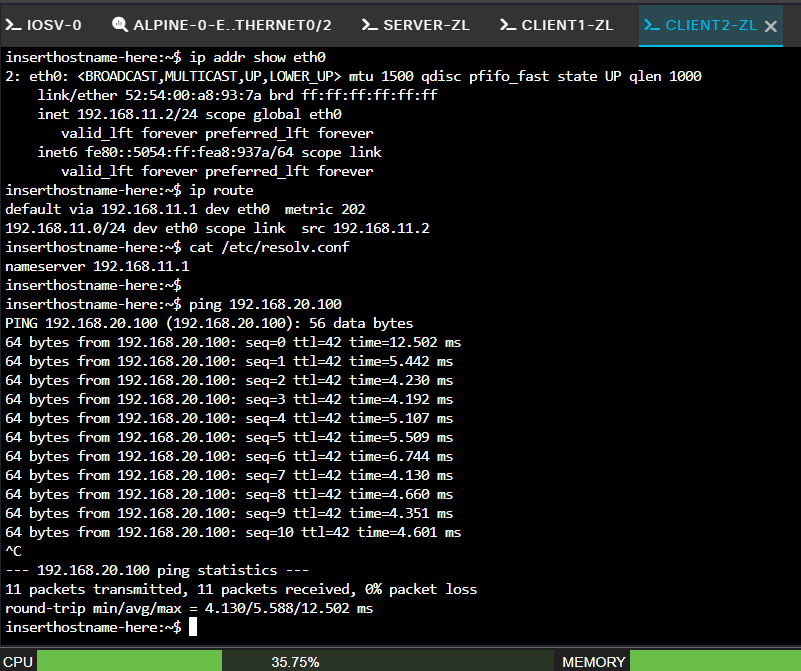
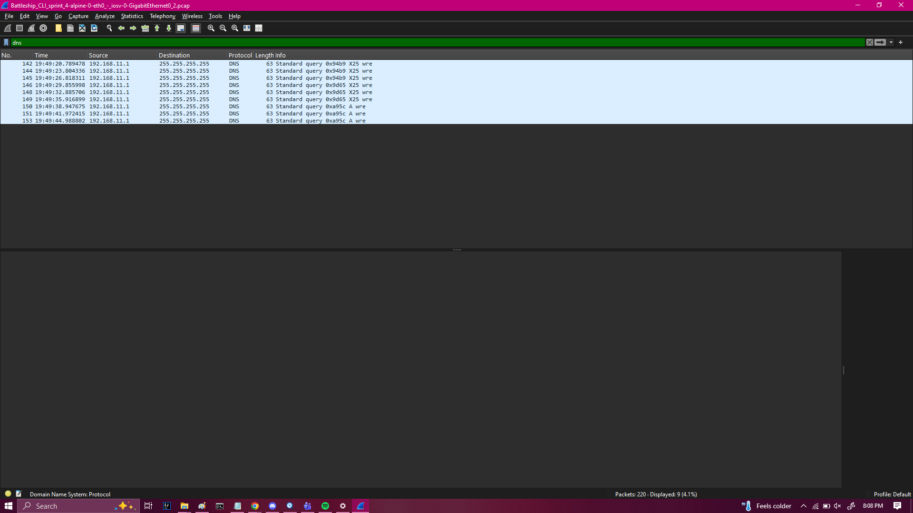
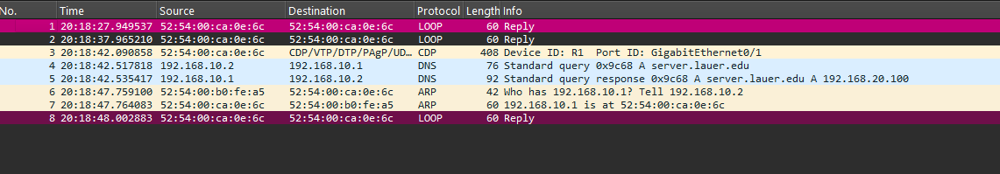

### Topology Screenshot:


This is an image detailing what the actual topology of my Cisco lab looks like for my project.  There are custom node names for each of them including client1-ZL, client2-ZL, R1-ZL(R for router), and also server-ZL.

### CLI outputs

These are screenshots detailing outputs, underlined in green, for specific intputs:
```
# On Client 1 and Client 2 Consoles (Alpine Linux):
sudo ip link set eth0 up
sudo udhcpc -i eth0

# Verify assigned IP, default gateway route, and DNS resolver:
ip addr show eth0
ip route
cat /etc/resolv.conf
```
as well as pinging each client.

**client1-ZL**



**client2-ZL**



### Wireshark DNS output
Here are each of the DNS protocols that were thrown.


**this** is a screenshot from sprint_4_packet_capture.pcap.



**this** is a screenshot from sprint_4_dns_lookup when using the command nslookup -type=A server.[yourlastname].edu.
